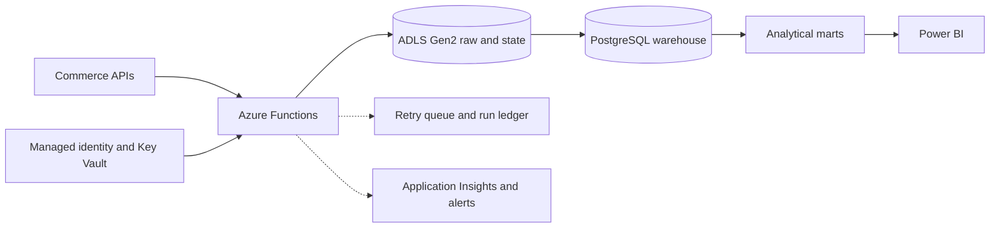

# Azure Data Warehouse Ingestion Platform

A production-oriented ingestion and warehouse architecture for collecting commerce data into an immutable data lake, validating each capture, rebuilding analytical models, and serving business intelligence.

## Problem solved

Commerce reporting depends on APIs with different pagination, timing, retry, and data-quality behavior. This platform provides one governed ingestion model with source-specific adapters, create-only raw evidence, run ledgers, scheduled retries, transactional warehouse rebuilds, and operational alerts.

## Architecture

## Technology

Python · Azure Functions · ADLS Gen2 · PostgreSQL · Azure Key Vault · Managed Identity · Bicep · GitHub Actions · Power BI

## Engineering highlights

- Stores immutable source responses with manifests and SHA-256 evidence.
- Maintains per-source run ledgers and idempotent retry behavior.
- Uses managed identity and OIDC instead of long-lived deployment secrets.
- Rebuilds reporting models within checked database transactions.
- Provides missing-run, exhausted-retry, quality, and runtime alerts.
- Defines cloud resources as versioned Bicep modules.

## Documentation

- [Architecture](docs/architecture.md)
- [Reliability model](docs/reliability.md)
- [Security model](docs/security.md)

> This repository presents a sanitized system design. Customer code, commercial data, infrastructure identifiers, documents, and credentials remain private.
