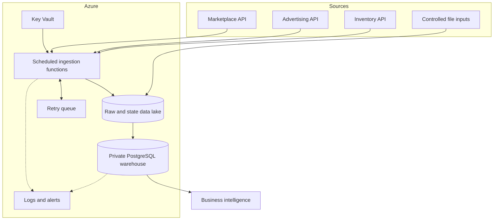

# Architecture

Every source implements a client, adapter, orchestration unit, schedule, and retry policy. Raw data lands first. The warehouse loads validated captures and rebuilds facts and marts in a single controlled model run.
